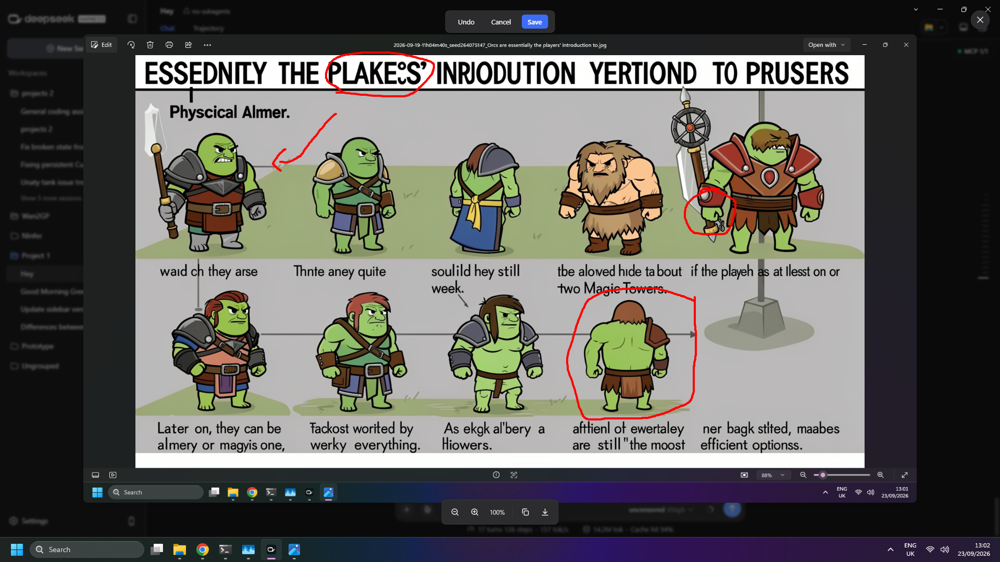
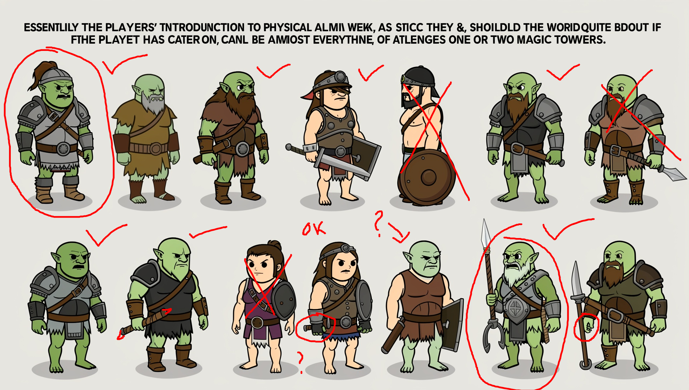

# dsh-image-annotator

Cursor-style image preview for [DeepSeek Harness](https://github.com/deepseek-ai/deepseek-harness) chat — a standalone plugin, built from scratch.

Click any image in the chat (message, trajectory, tool card, or composer draft). The product's own lightbox opens, and this plugin grafts the Cursor behavior onto it:

## Screenshots

| Drawing — red pen + Undo / Cancel / Save | Saved output — the annotated PNG |
| --- | --- |
|  |  |

## Controls

**Control pill (bottom center of the preview)**

| Control | Action |
| --- | --- |
| `−` / `+` | zoom out / zoom in (mouse wheel over the image also zooms; drag to pan when zoomed in) |
| copy icon | copies the image to the clipboard as PNG (annotations included while drawing) |
| download icon | downloads the image as PNG (annotations included while drawing) |
| `X` (top-right) | closes the preview — the product's own close control, backdrop/Escape unchanged |

**Drawing (top-right row, appears when you click the image)**

Click the image in the preview to start drawing with a red pen:

| Control | Action |
| --- | --- |
| **Undo** | drops the last stroke |
| **Cancel** | exits drawing, keeps the original image (Escape while drawing does the same) |
| **Save** | composites the annotated PNG and saves it: a live composer draft is swapped in place so it ships annotated with your message; a history image has every on-page copy (message thumbnail + preview) pointed at the annotated bytes. Then the preview closes. |

That is the whole feature set — nothing else.

## How it works

- No DSH source is touched. The plugin is a standalone bundle package; the product lightbox is detected structurally (body-portal `[role=dialog]`, `position:fixed`, an `img` that is either a direct child (DSH ≤ 0.1.7) or one level down in the stage wrapper (DSH ≥ 0.1.8), with `object-fit: contain`) and augmented in the DOM, torn down again on close.
- Pure browser code: one `MutationObserver`, a `<canvas>` overlay, `ClipboardItem`, and the product's own conversation API (`createDrafts` / `addAttachments` / `removeAttachment` / `releaseDraftAttachment`) for the draft swap.

## Install

```sh
dsh plugin --profile <name> add <path-to-dsh-image-annotator>   # local checkout
# or, once published:
dsh plugin --profile <name> add dsh-image-annotator
```

The bundle patch (`cordis.patch.yml`) self-mounts the row — no manual `cordis.patch.yml` edits.

## Files

- `lib/index.js` — host half (empty; the feature is browser-only)
- `lib/client.js` — client half (lightbox hook, zoom/copy/download, drawing row)
- `cordis.patch.yml` — bundle mount layer

## Platform

Any platform the Web GUI runs on (pure browser canvas/clipboard).

Tested against **DSH Desktop 0.14.0** (Harness core **0.2.2-rc.1**, Cordis 4.1.0 / Loader 1.1.0) and **DSH Desktop 0.12.1** (core 0.2.1-rc.2). See [CHANGELOG.md](CHANGELOG.md): 0.1.3 stops the bundle patch's double-mount guard from disabling the plugin's own row now that entry ids are namespaced (`include:dsh-image-annotator`) and stops `findDraftFor` from depending on the client `sessions.list` store, which Cordis 4.1 removed; 0.1.2 fixed the lightbox image moving one level down into a `.stage` wrapper; 0.1.1 fixed the 0.1.7 `sessions.list` snapshot shape.

On DSH 0.2.2+ the product no longer exposes a "which session is in the main view" signal, so if no session id can be discovered **Save** uses the on-page behaviour instead of swapping a live composer draft in place.
